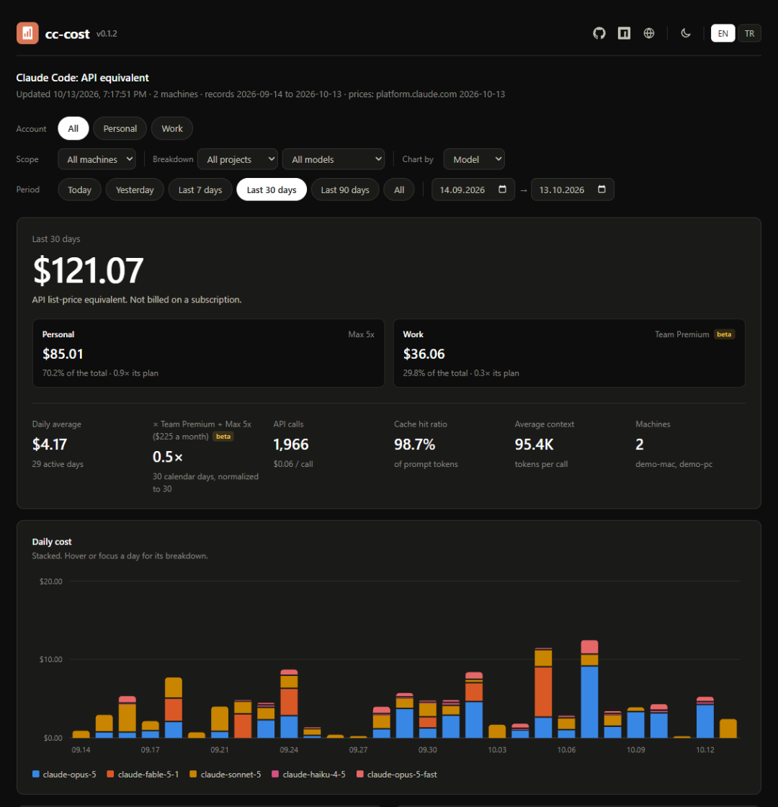
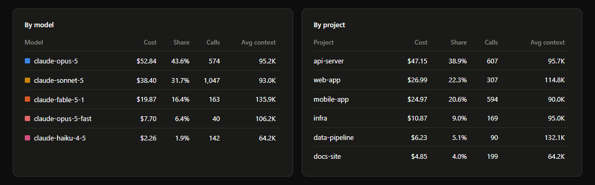
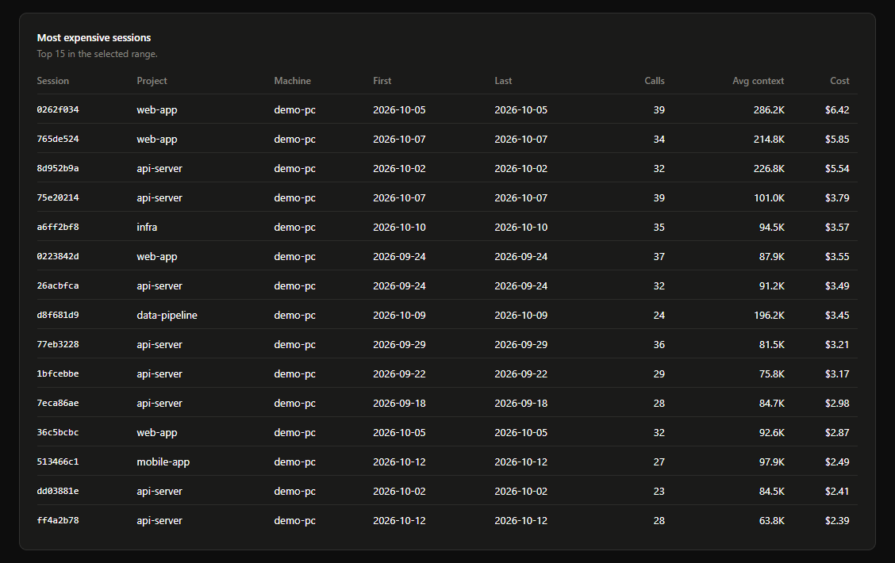
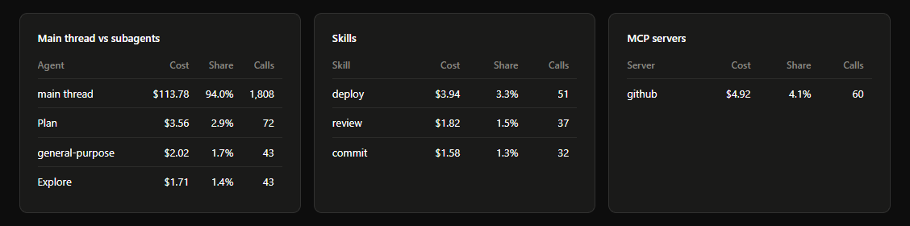
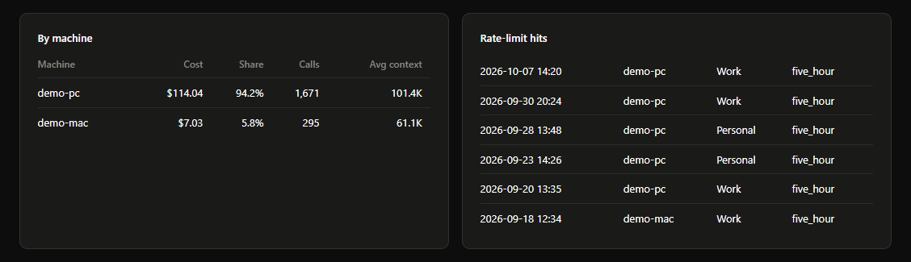
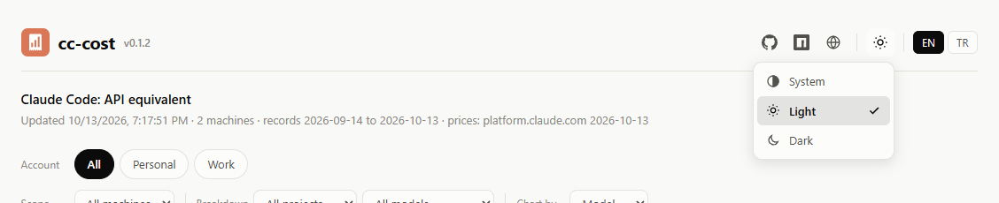
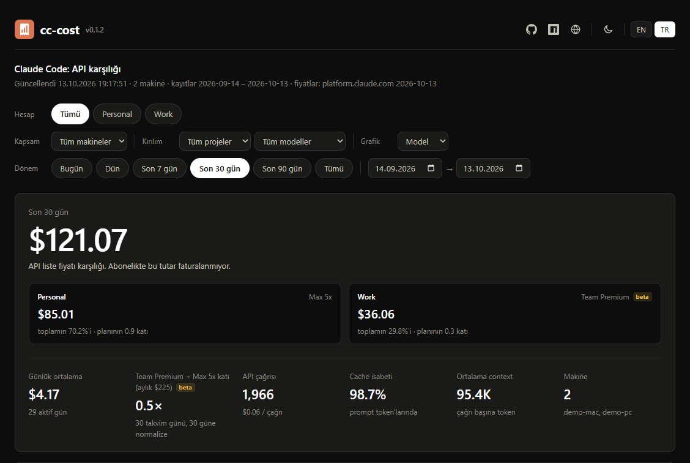
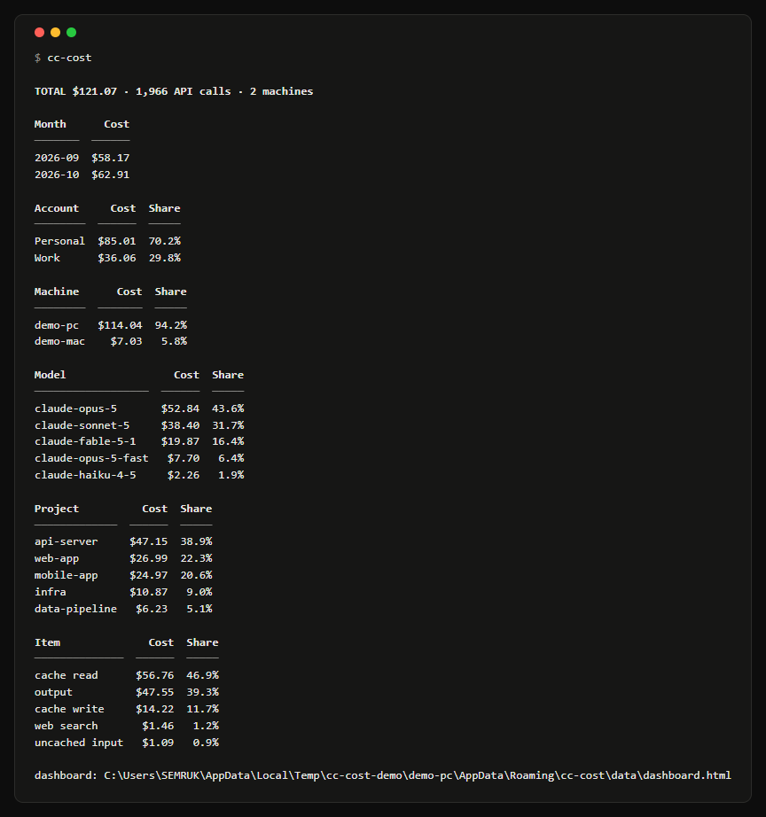
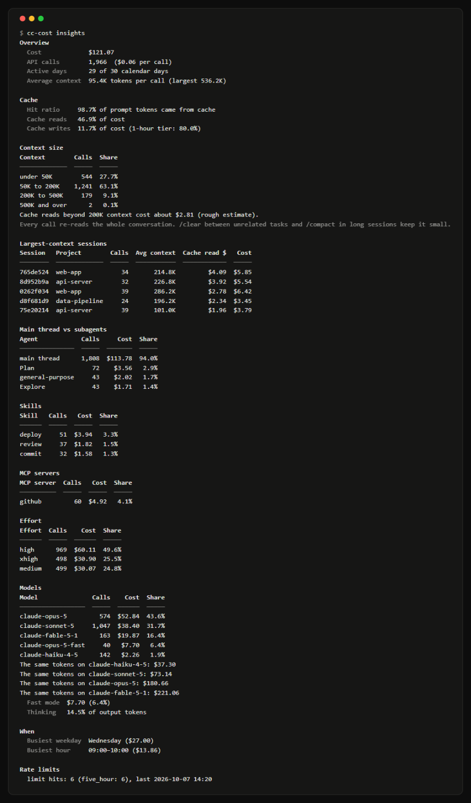
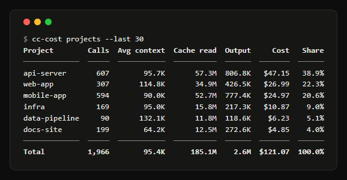

# Screenshots

All on the demo's sample data (`scripts/demo`): two machines, two Claude accounts (a Max 5x account and
a Team seat), 30 days of made-up usage. Window 1280 pixels wide.

## Dashboard

| | |
|---|---|
|  |  |
| The dashboard, dark | The same, light |
|  |  |
| Accounts: buttons to pick one, a card per account with its cost, share and multiple against its own plan | Daily cost stacked by account; also by model, project or machine |
|  |  |
| Where the cost goes, and calls by context size | Cost, share, calls and average context per model and per project |
|  |  |
| The most expensive sessions in the range | What subagents, skills and MCP servers cost |
|  |  |
| Per machine, and every rate-limit hit with its account | Light, dark, or whatever the system uses |
|  | |
| The dashboard in Turkish; the language switches on the page | |

## Terminal

| | |
|---|---|
|  |  |
| `cc-cost`: sync, then the summary by month, account, machine, model, project and token type | `cc-cost plan`: the API equivalent against every plan, then each account against its own |
|  |  |
| `cc-cost insights`: cache, context size, attribution, models, busiest times, limits | `cc-cost projects --last 30` |
